# Experiment 7: Using OSINT Tools for Reconnaissance

## Aim

Perform passive footprinting with Google search operators (“Google dorks”) and Shodan, and understand the kinds of public information these tools can expose.

## Objectives

- Understand passive information gathering.
- Learn how search operators locate publicly indexed pages and files.
- Understand the types of host, port, and service metadata Shodan may display.
- Interpret results carefully and only within an authorized scope.

## Scope and safety

The live demonstration was limited to `example.com`, a reserved domain used for documentation examples. No real organization, person, login, private document, camera, or public service was targeted. No active scan or connection to a discovered service was performed.

The PPT includes broader examples such as government/organization searches, exposed login pages, password directories, CCTV, and vulnerable services. Those were not run because no permission or target scope was provided. Do not copy those queries against real targets without explicit authorization.

## Requirements and tools

- Internet connection and a browser
- Google Search
- Shodan Search Engine
- Kali Linux is optional for browser use only; the slides state that no Metasploitable VM is needed for this passive OSINT exercise.

## Procedure and observed results

### Part A: Google search operators

1. Open Google Search.
2. Use `site:example.com` to restrict search results to the reserved example domain.
3. Run each domain-restricted query below. These are safe-scope demonstrations of the operators and examples in the presentation. Results depend on Google's index and may change over time.
4. Review snippets only; do not attempt to access private or sensitive material.

| Operation from the slides | Query run within the approved scope | Actual observed output |
|---|---|---|
| Limit results to a domain (`site:`) | `site:example.com` | Example Domain pages appeared. [Screenshot](Screenshots/03-google-site-operator.png) |
| Search a domain for PDFs (`site:` + `filetype:`; safe counterpart to the slide's NITJ example) | `site:example.com filetype:pdf` | No matching documents. [Screenshot](Screenshots/04-google-example-pdf.png) |
| Search page titles for directory wording (`intitle:`) | `site:example.com intitle:"index of"` | No exact quoted match; Google offered a broader unquoted query and an Example Domain result. This does not indicate an exposed directory. [Screenshot](Screenshots/06-google-example-directory.png) |
| Search a URL for login pages (`inurl:`) | `site:example.com inurl:login` | One Example Domain result appeared; no login page was opened. [Screenshot](Screenshots/10-google-login-url-example.png) |
| Combine admin URL and login terms (safe counterpart to the slide's `.org.in` example) | `site:example.com inurl:admin login` | Example Domain appeared; it is not an admin/login finding, and no login page was opened. [Screenshot](Screenshots/11-google-admin-login-example.png) |
| Search for spreadsheet/email paths (`filetype:` + `inurl:`) | `site:example.com filetype:xls inurl:email` | No matching documents. [Screenshot](Screenshots/09-google-xls-email-example.png) |
| Search for directory titles and password-related terms (safe counterpart to the slide's broad example) | `site:example.com intitle:index.of passwords` | No matching documents. [Screenshot](Screenshots/12-google-password-directory-example.png) |
| Try the slide's cached-page operator example | `cache:example.com` | Google returned an explanation that `cache:` is deprecated and no longer retrieves cached pages. [Screenshot](Screenshots/13-google-cache-example-domain.png) |

The slide's example `site:nitj.ac.in filetype:pdf` was not run against that real institution's domain; the PDF operation above uses the reserved example domain instead.

#### Google screenshots

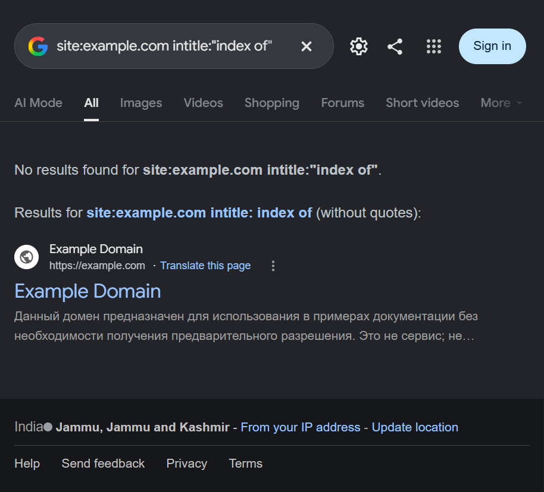

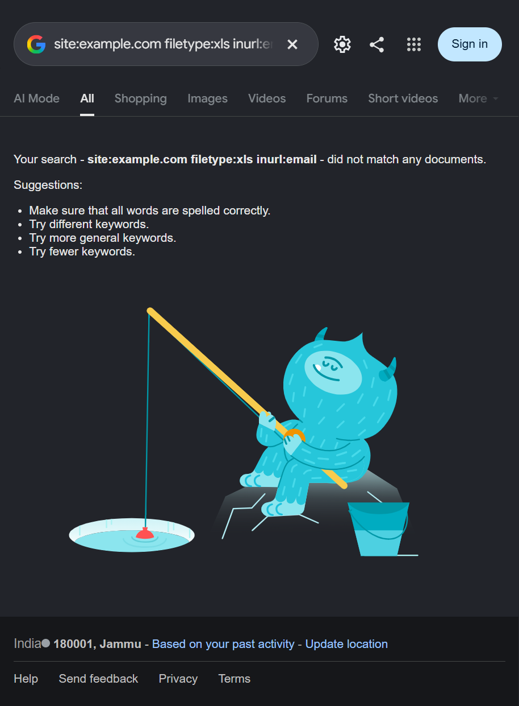

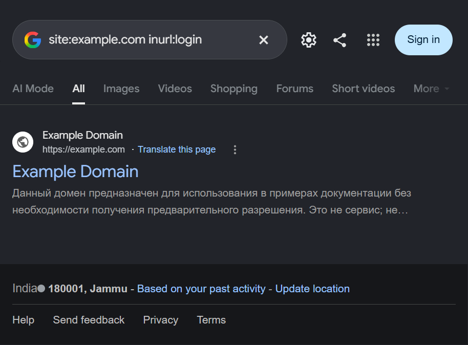

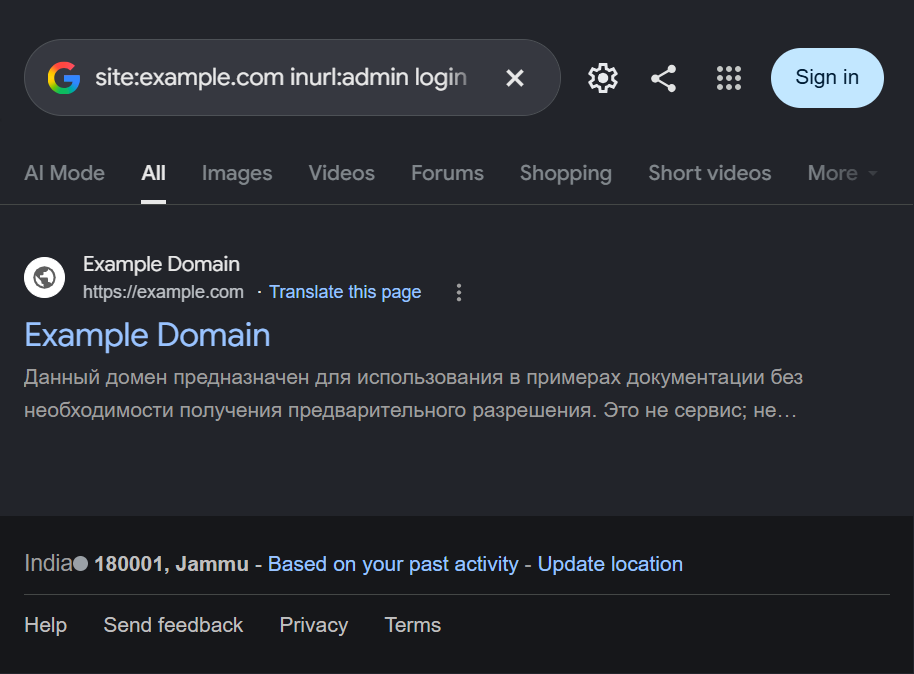

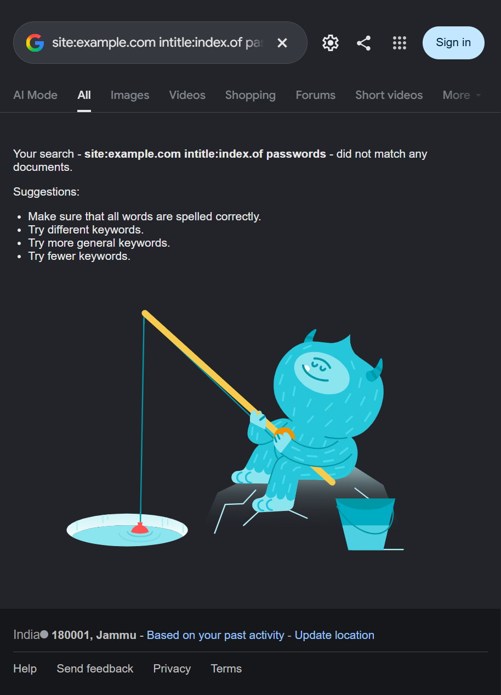

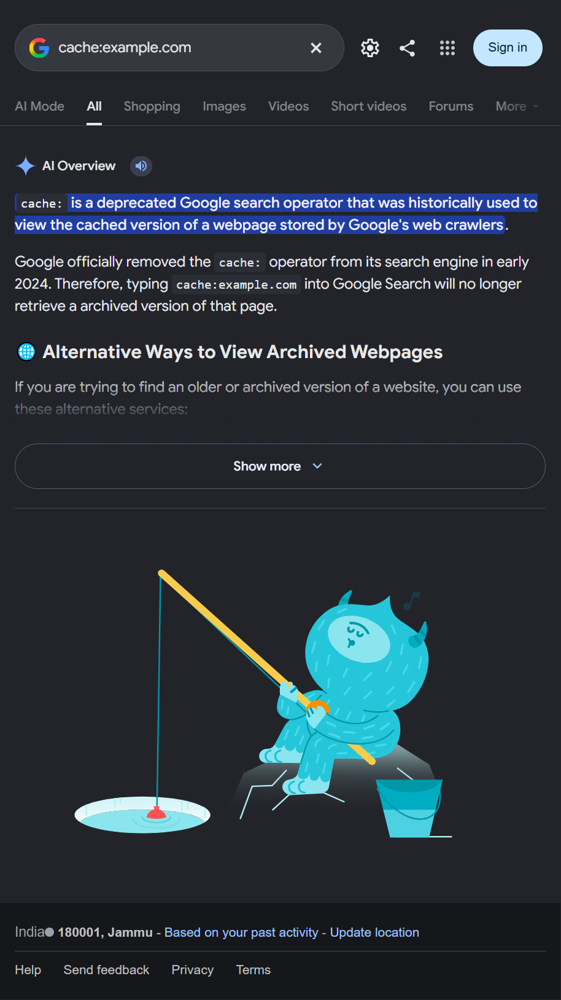

### Part B: Shodan

1. Open Shodan Search Engine.
2. Run the slide's query types with `hostname:example.com` added to every query, so searches remain restricted to the approved reserved domain.
3. Review the response; do not remove the hostname restriction or broaden the query to unrelated devices.

| Operation from the slides | Scoped query submitted | Actual observed output |
|---|---|---|
| Search by service/software term (`apache`) | `apache hostname:example.com` | Shodan required sign-in to use filters; no result records were available. [Screenshot](Screenshots/14-shodan-apache-example.png) |
| Search by organization (`org:`) | `org:"BSNL" hostname:example.com` | Shodan's free-search limit was reached; no filtered records were available. [Screenshot](Screenshots/15-shodan-org-example.png) |
| Search by port and country | `port:21 country:IN hostname:example.com` | Shodan's free-search limit was reached; no port findings were available. [Screenshot](Screenshots/16-shodan-ftp-example.png) |
| Search by product (`product:`) | `product:"MongoDB" hostname:example.com` | Shodan's free-search limit was reached; no product records were available. [Screenshot](Screenshots/17-shodan-mongodb-example.png) |
| Search by hostname (`hostname:`; safe counterpart to the slide's government-domain example) | `hostname:example.com` | Shodan's free-search limit was reached; filtered records were not available. [Screenshot](Screenshots/18-shodan-gov-hostname-example.png) |
| Search by Telnet port/country (scoped counterpart to the slide's example) | `port:23 country:IN hostname:example.com` | Shodan's free search limit was reached; no result records were available. [Screenshot](Screenshots/19-shodan-telnet-example.png) |
| Search by title (scoped counterpart to the camera-title example) | `title:"webcam 7" hostname:example.com` | Shodan's free search limit was reached; no result records were available. [Screenshot](Screenshots/20-shodan-webcam-example.png) |

Shodan blocked these searches at its sign-in/search-usage gate. Consequently, no host records, IP addresses, ports, service banners, organization details, or locations were obtained. A query visible in the search box is evidence that it was submitted, not evidence that a matching asset exists.

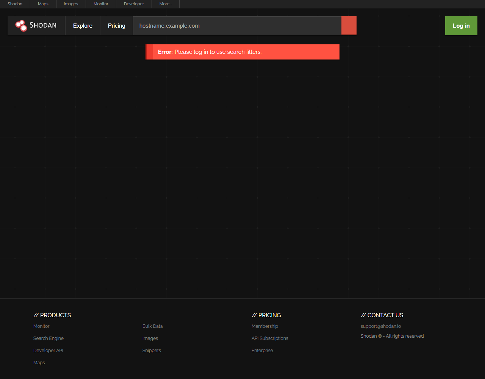

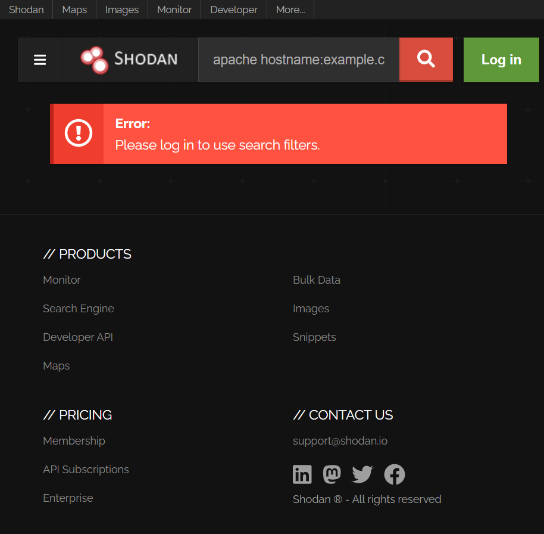

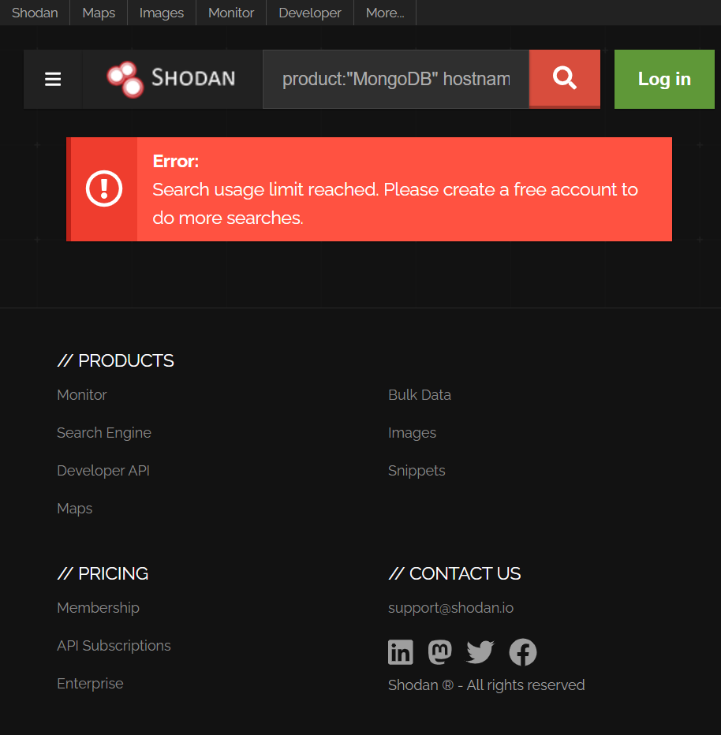

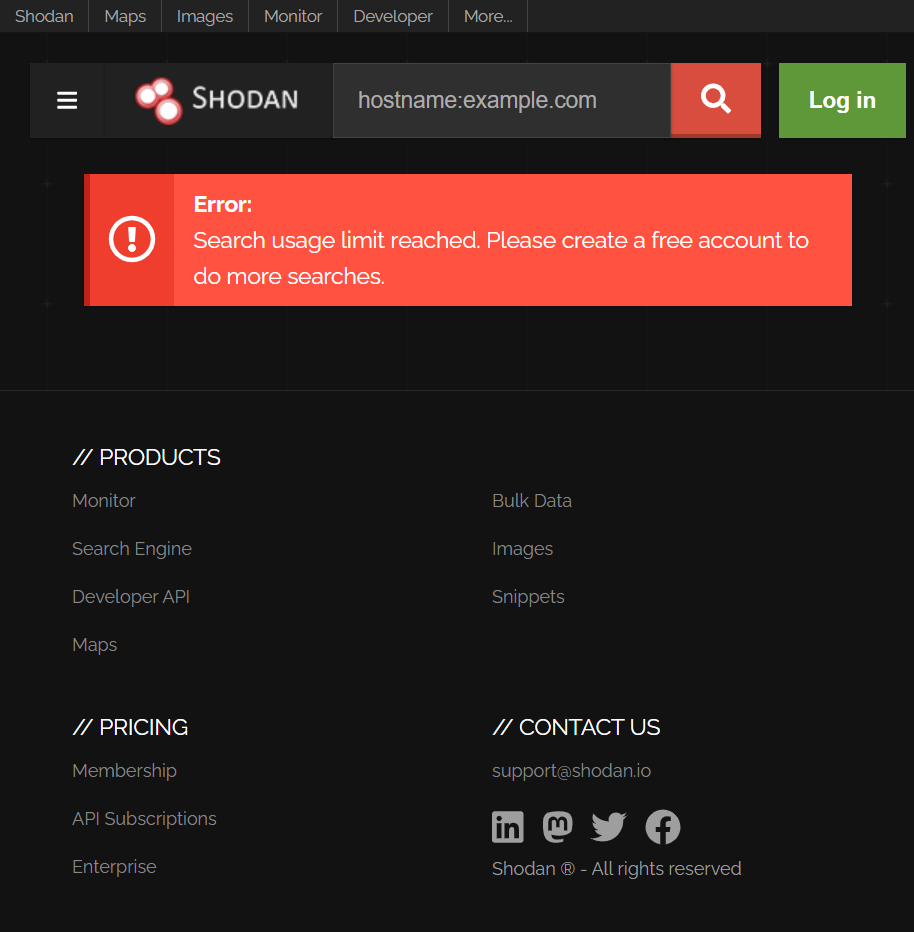

## Expected output compared with this run

The presentation explicitly labels slide 9's output as **samples**. Its exact illustrative entries are shown below for comparison; they are copied from the presentation, not live findings from this experiment.

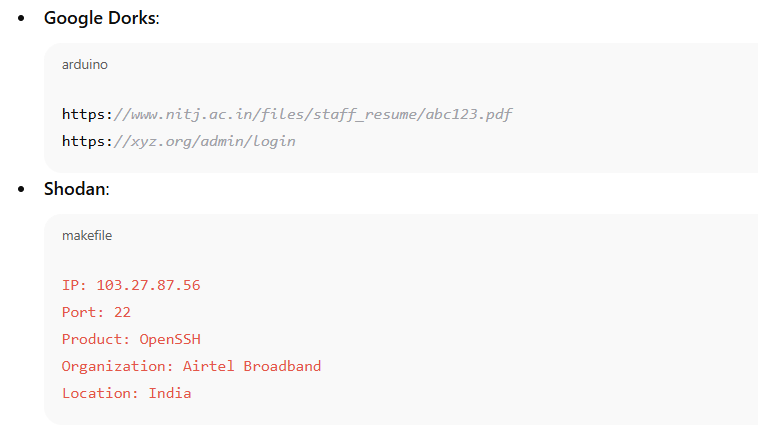

| Presentation sample | Exact value shown in the slide | Status in this experiment |
|---|---|---|
| Google dork: NITJ PDF search | `site:nitj.ac.in filetype:pdf` | Not run against NITJ; that real-domain query was replaced by `site:example.com filetype:pdf`. |
| Google dork: admin login search | `inurl:admin login site:org.in` | Not run against `.org.in`; the live query was restricted to `site:example.com inurl:admin login`. |
| Shodan IP | `103.27.87.56` | Shown only as PPT sample data; not queried or verified. |
| Shodan port | `22` | Shown only as PPT sample data; not queried or verified. |
| Shodan product | `OpenSSH` | Shown only as PPT sample data; not queried or verified. |
| Shodan organization | `Airtel Broadband` | Shown only as PPT sample data; not queried or verified. |
| Shodan location | `India` | Shown only as PPT sample data; not queried or verified. |

These are examples of the output format the presentation expects, not guaranteed results for an arbitrary target. They must not be represented as findings produced during this run.

The live run used the reserved-domain scope:

- Google returned example-domain pages for the `site:` and `inurl:login` queries, no PDF/XLS/password-directory matches, a broader result for the quoted directory-title search, and a deprecation explanation for `cache:`.
- The Google outputs do not match the presentation's illustrative sensitive-data examples because this experiment used only the reserved example domain.
- Shodan's filters were blocked by sign-in and free-search limits, so the expected IP/port/banner sample was not returned.
- No exposed credentials, personal information, vulnerable devices, open ports, or vulnerability findings were discovered or verified.

## Why these tools?

- **Google Search** can reveal pages and files already indexed by a search engine. An indexed result can be stale, incomplete, or misleading and must be verified within the authorized scope.
- **Shodan** indexes internet-facing service metadata and may show observed ports, banners, and device information. A listing is not proof that a service is currently reachable or vulnerable.
- Both can support defensive asset review without directly probing the target during this exercise; avoid opening or interacting with sensitive results.

## Reflection and slide consistency

The deck's final reflection questions and summary unexpectedly switch to a different lab about Nmap, Nessus, and Metasploitable 2. Those active scanning/vulnerability-assessment steps are not part of the OSINT procedure on slides 6–11 and were not performed here.

- **Nmap vs. Nessus:** Nmap discovers hosts and exposed services; Nessus checks systems for known vulnerabilities. Neither was run in this OSINT exercise.
- **Open ports / critical Nessus findings / mapping to Nmap:** Not assessed; this run produced no Nmap or Nessus results.
- **Why restrict unnecessary ports?** Unneeded exposed services increase the attack surface and should be disabled or restricted by firewall rules.
- **How should findings be mitigated?** Confirm ownership and exposure, close or restrict unnecessary services, patch affected software, and recheck using an authorized process.
- **Why use an isolated VM for active scanning?** It reduces risk to production systems and other users. The OSINT portion itself used only browser searches and did not require a target VM.
- **Ethics and real-world use:** Get written authorization, limit the scope, minimize collection of sensitive data, verify findings, and report them responsibly.
- **Defensive lesson:** Maintain an inventory of owned assets and periodically review what public search engines and asset indexes reveal, without treating unverified results as confirmed vulnerabilities.

## Conclusion

This run executed each Google operator/query example and each Shodan query type shown in the presentation, using the reserved `example.com` scope rather than real third-party organizations or assets. The observed results differ from the slide's sample output: Google returned only example-domain results, and Shodan required sign-in and then enforced its free-search limit. The PPT's IP/port/banner sample is illustrative, not a verified finding from this run. The Nmap/Nessus portion described in the deck's final slides remains a separate, unperformed experiment.
